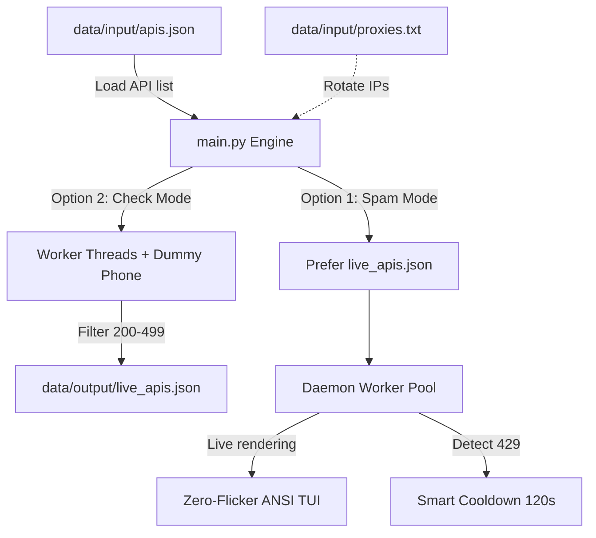

<div align="center">

# SMS / OTP BOMBER CORE

### *High-performance Multi-threaded OTP Benchmark & Security Stress-testing Engine*

[](https://github.com/)
[](https://www.python.org/)
[](LICENSE)
[](https://en.wikipedia.org/wiki/ANSI_escape_code)

</div>

---

## 📸 1. Visual / Demo


### 🖥️ Terminal Live Preview (Zero-Flicker ANSI Typography)
```text
SPAM SMS / OTP TOOL  v2.0.0  ● RUNNING  00:00:15

Target               : 0918123456
Market               : Vietnam
Engine               : 20 Threads | Proxy: 50 active
Round                : 2 / 5

Requests Sent        : 276
Successful Live      : 198
Failed / Dead        : 64
Throttled (429)      : 14
Success Rate         : 71.7%
Throughput           : 18.4 req/s

[11:14:02]  ✔ viettel_login        200 OK
[11:14:03]  ✔ tv360                200 OK
[11:14:04]  ✘ shopee               403 Forbidden
[11:14:05]  ! f88_pawn             429 Throttled (Cooldown 120s)
[Ctrl+C to stop]
```

---

## ⚡ 2. Purpose & Features

**SMS / OTP Bomber Core** is a load-benchmark for OTP verification endpoints — a stress-testing and rate-limit evaluation tool for telecom, e-commerce, and fintech systems.

* **Rich API pool:** Ships with **192 APIs** across two key markets: Vietnam (`vn`) and India (`in`).
* **Daemon Threads + Queue architecture:** Thread-safe work-queue management with a **bounded-execution budget** (hard time cap), completely eliminating process hangs caused by a dead endpoint holding a socket.
* **Adaptive phone formatting:** Transparently converts numbers across 5 formats (`raw`, `vn84`, `vn84plus`, `plus91`, `91dash`) to match each endpoint's payload.
* **Round-robin ProxyPool:** Evenly rotates load through an HTTP/HTTPS proxy list in a thread-safe way, and safely no-ops when proxies are disabled.
* **Smart rate-limit cooldown:** Automatically detects `429 Too Many Requests` to trigger a **120s** cooldown, and **60s** for other `4xx` errors — protecting your IP and avoiding wasted requests.
* **Minimalist zero-flicker ANSI UI:** The whole viewport is drawn from a single buffer with VT cursor control — no flicker, no heavyweight dependency like `rich`.
* **Two independent operating modes:**
  * **Check Mode:** Probes endpoints with dummy phone numbers (never sends a real OTP) and saves the live list to `live_apis.json`.
  * **Spam Mode:** Automatically prefers the verified live endpoints for maximum speed and success rate.

---

## ⚠️ 3. Disclaimer & Security Warning

> **LEGAL & SECURITY DISCLAIMER**

* **Educational & testing purposes only:** This project exists for information-security research, load/stress testing, and evaluating rate-limit mechanisms. The author accepts **absolutely no responsibility** for misuse, harassment, sabotage, or any unlawful activity committed with this tool.
* **Protect your credentials:** Never put personal tokens, cookies, session keys, or passwords into API payload files.
* **Git safety:** Before pushing to GitHub/GitLab, always check your `.gitignore` so you never leak:
  * `data/input/proxies.txt` (proxy IPs and accounts)
  * `data/output/live_apis.json`
  * `.env` files and other sensitive configuration files.

---

## 🚀 4. Installation & Quick Start

### Environment requirements
* **Python:** 3.9+
* **OS:** Windows 10/11, macOS, Linux (ANSI-aware terminals)

### Step 1: Clone & install dependencies
```bash
git clone https://github.com/your-username/sms-bomber-core.git
cd sms-bomber-core

# Minimal dependencies — only requests & urllib3
pip install -r requirements.txt
```

### Step 2: Configure input data
1. **API definitions:** `data/input/apis.json` already ships with 192 APIs. Add new endpoints using this template:
   ```json
   {
     "name": "example_service",
     "market": "vn",
     "method": "POST",
     "phone_fmt": "raw",
     "url": "https://api.example.com/v1/send-otp",
     "headers": { "Content-Type": "application/json" },
     "json": { "phone": "{phone}" }
   }
   ```
2. **Proxies (optional):** Add one proxy per line to `data/input/proxies.txt`:
   ```text
   103.152.112.120:8080
   user:password@45.77.12.34:3128
   ```

### Step 3: Run

#### Interactive menu
```bash
python main.py
```
You will see a minimal menu:
```text
SPAM SMS / OTP TOOL  v2.0.0
192 API loaded

> 1. Spam
> 2. Check API
> 3. Exit

› Select option (1/2/3):
```

#### Direct CLI
```bash
# Scan live APIs for the Vietnam market
python main.py check vn

# Scan for India or all markets
python main.py check in
python main.py check all

# Fire directly: python main.py spam <phone> [rounds] [market]
python main.py spam 0918123456 3 vn
```

---

## 📂 5. Directory Structure & Workflow

### 🌲 Directory tree
```text
sms-bomber-core\
├── main.py                     # Single source file driving the whole engine & TUI
├── requirements.txt            # Minimal dependencies (requests, urllib3)
├── data\
│   ├── input\
│   │   ├── apis.json           # 192 API definitions (VN / IN)
│   │   └── proxies.txt         # Round-robin proxy list (optional)
│   └── output\
│       └── live_apis.json      # Auto-saved live API list after a Check run
├── LICENSE                     # MIT License
├── .gitignore                  # Excludes proxies.txt, live_apis.json, caches
└── README.md                   # Project documentation
```

### 🔄 Workflow



---

## 🛠️ 6. Troubleshooting / FAQ

### ❓ 1. `ModuleNotFoundError: No module named 'requests'`
* **Cause:** Missing the core networking library.
* **Fix:**
  ```bash
  pip install requests urllib3
  ```

### ❓ 2. Proxies fail to connect or requests hang
* **Cause:** Wrong proxy format, or dead/slow proxies.
* **Fix:**
  * Use a valid format: `ip:port` or `username:password@ip:port`.
  * The tool enforces a hard budget (60s/45s), so overly slow proxies are skipped automatically without stalling the whole pipeline.

### ❓ 3. Too many `429 Throttled` messages
* **Cause:** The endpoint is rate-limiting your current IP.
* **Fix:**
  * Enable proxies in `data/input/proxies.txt` to rotate IPs continuously.
  * Increase the delay between rounds in the setup prompts.

### ❓ 4. Console shows raw escape codes (e.g. `[1;92m`)
* **Cause:** Legacy Windows consoles without Virtual Terminal (VT) processing.
* **Fix:**
  * Run inside **Windows Terminal**, **PowerShell 7+**, or **VSCode Integrated Terminal**.
  * The tool already enables native VT on Windows 10+ via `os.system("")`.

---

## 🌐 7. Connect & Support

Questions, contributions, or technical support — reach out through the official channels:

* 💬 **Discord Community:** [https://discord.gg/rxw8Hwk3qA](https://discord.gg/rxw8Hwk3qA)
* 🎵 **TikTok:** [@lakofusion](https://www.tiktok.com/@lakofusion)
* 📺 **YouTube:** [@lakofusion2010](https://www.youtube.com/@lakofusion2010)

---

## 📜 8. License

This project is distributed under the **MIT License**. You are free to use, modify, integrate, and redistribute the source for non-commercial or research purposes, provided the original copyright notice is retained.
